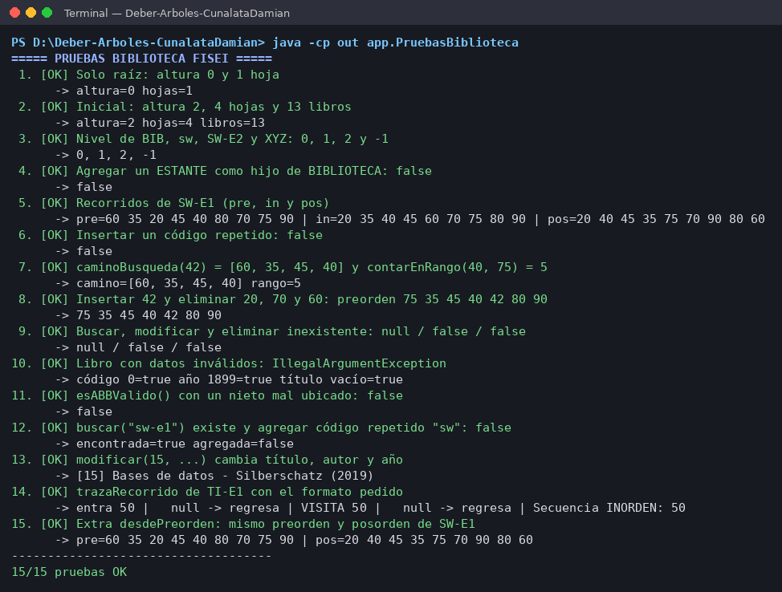

# Catálogo de la Biblioteca FISEI con árbol general y ABB en Java

**Asignatura:** Estructura de Datos · **Nivel:** Tercero – Ingeniería de Software
**Estudiante:** Luis Silva · **Modalidad:** Individual

## Problema

La Biblioteca FISEI se organiza en **Áreas** y cada Área en **Estantes**. Esta jerarquía se representa con un **árbol general n-ario** (`ArbolBiblioteca`) que respeta el orden BIBLIOTECA → AREA → ESTANTE.

Cada Estante guarda sus libros en un **Árbol Binario de Búsqueda** (`CatalogoABB`) ordenado por el código del libro, que es un entero positivo y no se repite.

La aplicación permite construir, consultar, recorrer y modificar las dos estructuras. Todas las operaciones de los árboles son **recursivas** y no usan TreeSet, TreeMap, PriorityQueue ni ordenamientos de listas.

Estructura inicial:

```
BIB  Biblioteca FISEI
├── SW   Software
│    ├── SW-E1  Estante 1 de Software   →  60, 35, 80, 20, 45, 70, 90, 40, 75
│    └── SW-E2  Estante 2 de Software   →  15, 10, 25
├── TI   Tecnologías de la Información
│    └── TI-E1  Estante 1 de TI         →  50
└── TEL  Telecomunicaciones
```

La estructura tiene 7 unidades, 4 hojas, altura de 2 aristas y 13 libros.

## Organización del proyecto

```
src/
├── enums/    TipoUnidad.java, TipoRecorrido.java
├── modelo/   Libro.java, UnidadBiblioteca.java
├── negocio/  NodoUnidad.java, NodoLibro.java,
│             ArbolBiblioteca.java, CatalogoABB.java
└── app/      Main.java, DatosPrueba.java, PruebasBiblioteca.java
```

| Clase | Responsabilidad |
|---|---|
| `TipoUnidad` | BIBLIOTECA, AREA y ESTANTE, con `puedeTenerHijo()` |
| `TipoRecorrido` | PREORDEN, INORDEN y POSORDEN |
| `Libro` | Código (sin setter), título, autor y año, con validaciones |
| `UnidadBiblioteca` | Código en mayúsculas, nombre y tipo |
| `NodoUnidad` | Nodo del árbol general: dato, hijos y catálogo (solo estantes) |
| `NodoLibro` | Nodo del ABB: dato, izquierdo y derecho |
| `ArbolBiblioteca` | agregar, buscar, altura, contarHojas, nivel, mostrarJerarquia, contarLibrosTotal |
| `CatalogoABB` | insertar, buscar, contar, recorrer, trazaRecorrido, modificar, eliminar, retos y extra `desdePreorden` |
| `Main` | Menú interactivo con Scanner |
| `DatosPrueba` | Carga la estructura inicial |
| `PruebasBiblioteca` | 15 casos de prueba con el resultado `X/N pruebas OK` |

## Instrucciones de ejecución

Se necesita Java 11 o superior. Desde la carpeta del proyecto, en PowerShell o en la terminal de VS Code:

```bash
# Compilar
javac -encoding UTF-8 -d out src/enums/*.java src/modelo/*.java src/negocio/*.java src/app/*.java

# Menú interactivo
java -cp out app.Main

# Casos de prueba
java -cp out app.PruebasBiblioteca
```

En el menú, la **opción 1** carga la estructura inicial. Las opciones de libros piden primero el código del estante, por ejemplo `SW-E1`.

## Captura de PruebasBiblioteca



## Otras capturas

| Captura | Contenido |
|---|---|
| [cap02](docs/capturas/cap02_menu_jerarquia.png) | Menú y jerarquía inicial |
| [cap03](docs/capturas/cap03_unidades.png) | Agregar, buscar unidades, altura, hojas, nivel y total |
| [cap04](docs/capturas/cap04_libros.png) | Buscar, modificar y libro inexistente |
| [cap05](docs/capturas/cap05_recorridos_retos.png) | Recorridos y retos |
| [cap06](docs/capturas/cap06_trazas_personal.png) | Inserción de los códigos personales 32, 28 y 82 y recorridos |
| [cap06b](docs/capturas/cap06b_traza_preorden.png) | Traza del preorden con los códigos personales |
| [cap07](docs/capturas/cap07_eliminaciones.png) | Eliminaciones de hoja, un hijo y dos hijos |

El desarrollo a mano está en [TRAZAS.md](TRAZAS.md).
