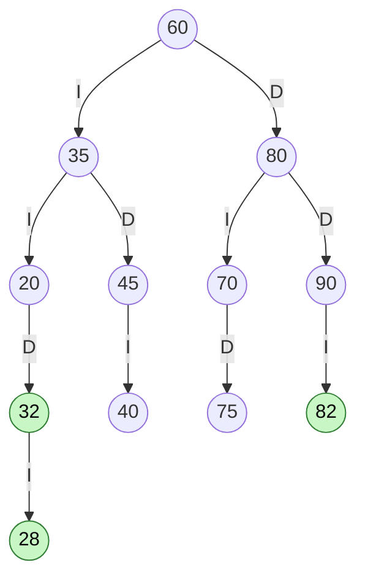
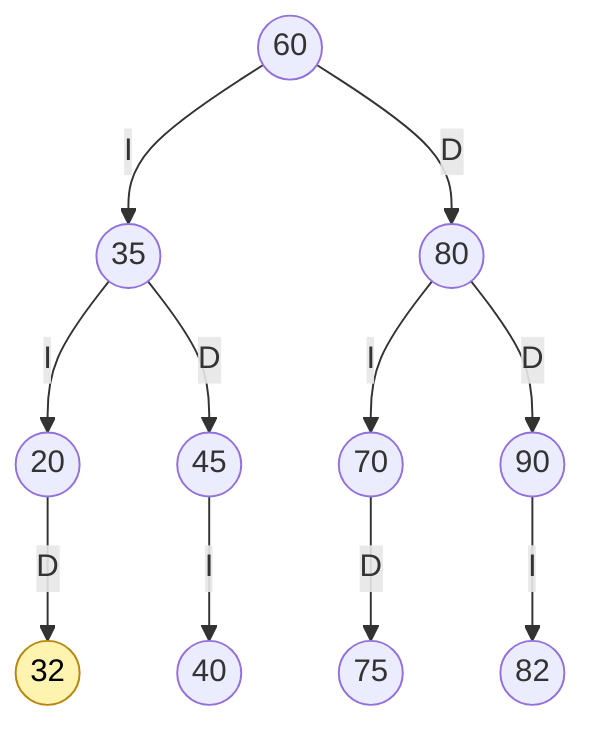
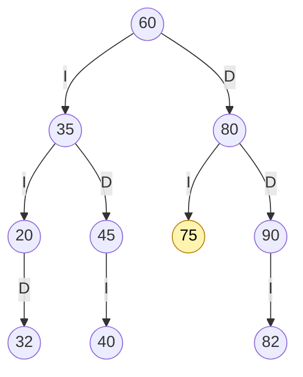
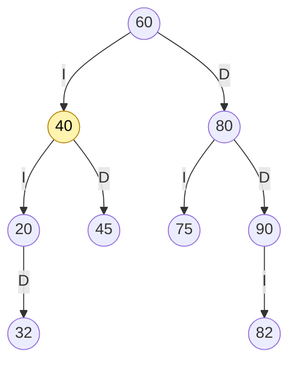

# TRAZAS.md · Desarrollo a mano

**Estudiante:** Damian Cunalata · **Estante usado:** SW-E1

## 1. Códigos personales

Últimos 4 dígitos de la cédula: **3282**, así que a = 3, b = 2, c = 8 y d = 2.

| Código | Dígitos | Valor | ¿Es 0, se repite o ya existe en SW-E1? | Código final |
|---|---|---|---|---|
| ab | 3 y 2 | 32 | No | **32** |
| bc | 2 y 8 | 28 | No | **28** |
| cd | 8 y 2 | 82 | No | **82** |

SW-E1 tiene 60, 35, 80, 20, 45, 70, 90, 40 y 75. Ninguno de los tres códigos está ahí, así que no hubo que sumar 1.

## 2. Inserción

Primero se inserta la secuencia de SW-E1 (60, 35, 80, 20, 45, 70, 90, 40, 75) y después los códigos personales en el orden 32, 28, 82.

| Inserta | Camino (comparaciones) | Queda como |
|---|---|---|
| 32 | 60 (32 < 60, izq) → 35 (32 < 35, izq) → 20 (32 > 20, der) → vacío | hijo **derecho** de 20 |
| 28 | 60 (izq) → 35 (izq) → 20 (28 > 20, der) → 32 (28 < 32, izq) → vacío | hijo **izquierdo** de 32 |
| 82 | 60 (82 > 60, der) → 80 (82 > 80, der) → 90 (82 < 90, izq) → vacío | hijo **izquierdo** de 90 |

## 3. ABB final

Aristas: **I** = hijo izquierdo y **D** = hijo derecho. En verde están los códigos personales.



- 12 libros.
- Altura 4. El camino más largo es 60 → 35 → 20 → 32 → 28.
- Hojas: 28, 40, 75 y 82.

## 4. Recorridos

| Recorrido | Regla | Resultado |
|---|---|---|
| Preorden | nodo → izq → der | 60 35 20 32 28 45 40 80 70 75 90 82 |
| Inorden | izq → nodo → der | 20 28 32 35 40 45 60 70 75 80 82 90 |
| Posorden | izq → der → nodo | 28 32 20 40 45 35 75 70 82 90 80 60 |

Comprobación: el inorden queda ordenado de menor a mayor, así que el ABB es correcto.

### Traza del preorden

`entra X` = llega al nodo, `VISITA X` = lo procesa y `null -> regresa` = hijo vacío (caso base). Hay 2 espacios por nivel.

```
entra 60
VISITA 60
  entra 35
  VISITA 35
    entra 20
    VISITA 20
      null -> regresa
      entra 32
      VISITA 32
        entra 28
        VISITA 28
          null -> regresa
          null -> regresa
        null -> regresa
    entra 45
    VISITA 45
      entra 40
      VISITA 40
        null -> regresa
        null -> regresa
      null -> regresa
  entra 80
  VISITA 80
    entra 70
    VISITA 70
      null -> regresa
      entra 75
      VISITA 75
        null -> regresa
        null -> regresa
    entra 90
    VISITA 90
      entra 82
      VISITA 82
        null -> regresa
        null -> regresa
      null -> regresa
```

Hay 13 `null -> regresa`. Siempre son N + 1 = 12 + 1, porque cada nodo tiene 2 punteros y N − 1 de ellos apuntan a nodos.

## 5. Eliminaciones

Se hacen en este orden sobre el ABB final: 28, luego 70, luego 35.

### 5.1 Hoja: eliminar 28

28 no tiene hijos, así que se quita y el izquierdo de 32 queda en `null`.



Preorden: 60 35 20 32 45 40 80 70 75 90 82

### 5.2 Un hijo: eliminar 70

70 solo tiene el hijo derecho 75. El 75 sube y ocupa su lugar como hijo izquierdo de 80.



Preorden: 60 35 20 32 45 40 80 75 90 82

### 5.3 Dos hijos: eliminar 35

35 tiene dos hijos (20 y 45), así que se reemplaza por su **sucesor inorden**, que es el menor del subárbol derecho: 45 → izquierda → **40**.

1. Se copia 40 en el lugar de 35.
2. Se elimina el 40 original del subárbol derecho. Era una hoja, así que el izquierdo de 45 queda en `null`.

Se usa el sucesor inorden porque es mayor que todo el subárbol izquierdo (20, 32) y menor que todo lo que queda a la derecha (45). Así el ABB sigue siendo válido.



| Recorrido | Resultado final |
|---|---|
| Preorden | 60 40 20 32 45 80 75 90 82 |
| Inorden | 20 32 40 45 60 75 80 82 90 |
| Posorden | 32 20 45 40 75 82 90 80 60 |

## 6. Comparación con la salida del programa

La salida se obtuvo con el menú (`java -cp out app.Main`):
- opción 1, para cargar la estructura inicial;
- opción 6, para insertar 32, 28 y 82 en SW-E1;
- opción 10, para los recorridos y la traza;
- opción 11, para los retos;
- opción 9, para las eliminaciones.

Capturas: `docs/capturas/cap06_trazas_personal.png`, `docs/capturas/cap06b_traza_preorden.png` y `docs/capturas/cap07_eliminaciones.png`.

| Punto | A mano | Salida del programa | ¿Coincide? |
|---|---|---|---|
| Preorden con códigos personales | 60 35 20 32 28 45 40 80 70 75 90 82 | `Preorden: 60 35 20 32 28 45 40 80 70 75 90 82` | Sí |
| Inorden | 20 28 32 35 40 45 60 70 75 80 82 90 | `Inorden:  20 28 32 35 40 45 60 70 75 80 82 90` | Sí |
| Posorden | 28 32 20 40 45 35 75 70 82 90 80 60 | `Posorden: 28 32 20 40 45 35 75 70 82 90 80 60` | Sí |
| Traza del preorden | Sección 4 | `Secuencia PREORDEN: 60 35 20 32 28 45 40 80 70 75 90 82` | Sí |
| Camino de 28 | 60 → 35 → 20 → 32 → 28 | `Camino: [60, 35, 20, 32, 28]` | Sí |
| Eliminar 28 (hoja) | 60 35 20 32 45 40 80 70 75 90 82 | `Preorden: 60 35 20 32 45 40 80 70 75 90 82` | Sí |
| Eliminar 70 (un hijo) | 60 35 20 32 45 40 80 75 90 82 | `Preorden: 60 35 20 32 45 40 80 75 90 82` | Sí |
| Eliminar 35 (dos hijos) | 60 40 20 32 45 80 75 90 82 | `Preorden: 60 40 20 32 45 80 75 90 82` | Sí |
| Inorden final | 20 32 40 45 60 75 80 82 90 | `Inorden:  20 32 40 45 60 75 80 82 90` | Sí |
| Posorden final | 32 20 45 40 75 82 90 80 60 | `Posorden: 32 20 45 40 75 82 90 80 60` | Sí |
| ABB válido al final | Sí | `esABBValido: true` | Sí |
